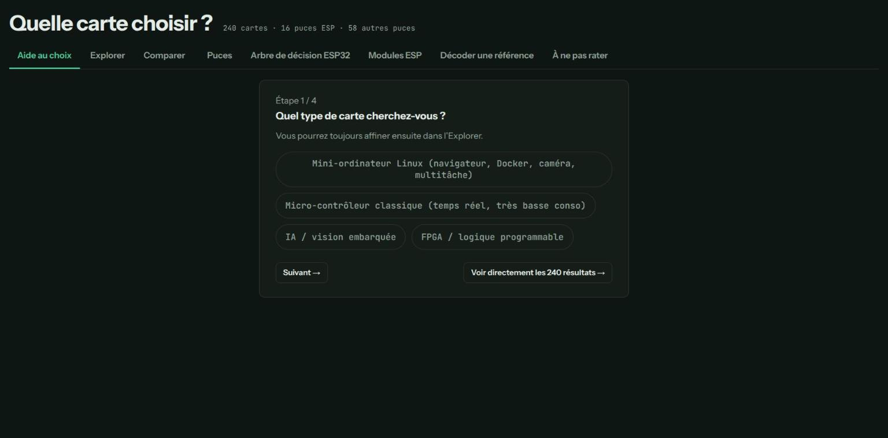

# Quelle carte choisir ?



> _Capture de l'outil en ligne — [version live](https://rom98759.github.io/carte-select-iot/)._


Un outil pour aider à choisir une carte de développement IoT/embarqué (ESP32, Arduino, Raspberry Pi Pico, STM32, SBC Linux, FPGA, IA embarquée, LoRa…) parmi plus de 240 cartes et 90 puces.

**[Ouvrir l'outil](https://rom98759.github.io/carte-select-iot/)**

## Ce que ça fait

- **Aide au choix** : un assistant par questions (type de carte, radio, encombrement, outils) qui filtre en direct et propose les cartes correspondantes.
- **Explorer** : recherche et filtres détaillés (GPIO, RAM, radio, USB, logiciel…) sur l'ensemble des cartes, avec comparateur (jusqu'à 5 cartes côte à côte).
- **Puces** : tableau comparatif des 16 puces Espressif (ESP8266 à la gamme ESP32 récente) et de 58 autres puces/SoC toutes marques.
- **Arbre de décision ESP32** : schéma interactif pour choisir une puce Espressif précise question par question.
- **Modules ESP** : près de 90 références de modules et variantes (WROOM, WROVER, MINI…).
- **Décoder une référence** : comprendre une désignation comme `ESP32-S3-WROOM-1-N16R8`.

## Technique

Une seule page HTML autonome (pas de dépendance, pas de build), en français. Toutes les données sont vérifiées manuellement (voir les commits pour l'historique des corrections) mais peuvent devenir datées — une carte peut changer de révision matérielle sans que son nom change. Une erreur repérée ? Ouvrez une issue ou une pull request.

## Lancer en local

```bash
python3 -m http.server 8000
```

puis ouvrez `http://localhost:8000/index.html`.

## Licence

MIT — voir [LICENSE](LICENSE).
